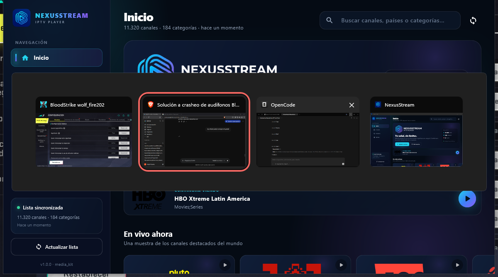
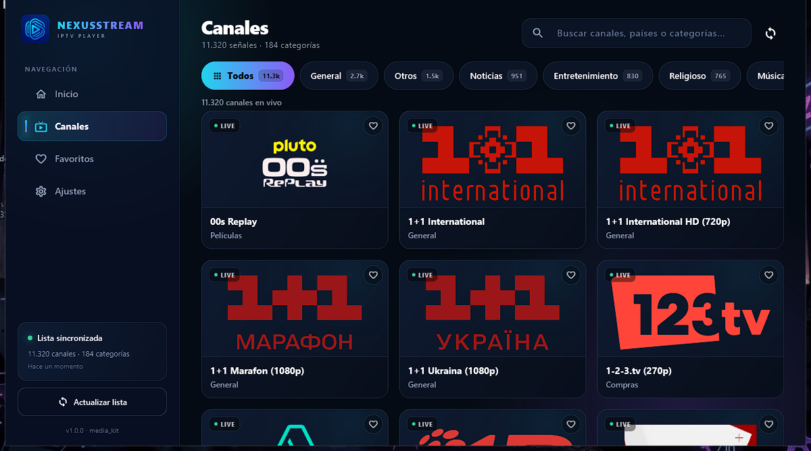

# NexusStream (app Flutter)

Reproductor IPTV multiplataforma construido con Flutter y `media_kit` (libmpv).


Funciona en **Android móvil**, **Android TV** y **Windows** con la misma base de
código.


| Inicio (escritorio) | Canales |
| --- | --- |
|  |  |

## Características

- **IPTV-Org + WiwyXuper**: lista pública y portal completo, seleccionables desde
  Ajustes.
- **Canales en vivo** con categorías automáticas y **ESPN fusionado** en
  *Deportes*.
- **Películas y series** con pósters, búsqueda, ficha, temporadas y episodios.
- **Subtítulos externos** del portal, con español automático y selector manual.
- **Favoritos**, último canal y reanudación de VOD.
- **VPN OpenVPN nativa** en Android/Android TV (perfil Netxxus + respaldo
  VPNOK), con conexión automática opcional.
- **Proxy HTTP** configurable en Windows.
- **Interfaz adaptativa** para TV (D-pad), móvil y escritorio, con temas,
  wallpapers e imagen propia.
- Caché local y refresco automático de credenciales/CDN sin intervención.

## Requisitos

- Flutter 3.47+ (Dart 3.13+).
- **Windows**: Visual Studio 2022 con *Desktop development with C++*.
- **Android**: Android SDK 36, JDK 17+ y un dispositivo/emulador.
- Licencias de Android aceptadas:

  ```bash
  flutter doctor --android-licenses
  ```

## Ejecutar

```bash
flutter pub get
flutter run -d windows
flutter run -d android
```

## Compilar

```bash
flutter build windows --release
flutter build apk --release
```

Instalador de Windows (después de compilar la app):

```powershell
& "$env:LOCALAPPDATA\Programs\Inno Setup 6\ISCC.exe" ..\installer.iss
```

Artefactos:

- Windows: `build/windows/x64/runner/Release/`
- Instalador: `../dist/NexusStream-Setup-1.0.0.exe`
- Android: `build/app/outputs/flutter-apk/app-release.apk`

El APK de distribución se firma con el keystore local y se copia como
`../dist/NexusStream-1.0.0.apk`. Instrucciones completas en
[`../docs/SIGNING.md`](../docs/SIGNING.md) y
[`../docs/WINDOWS_INSTALLER.md`](../docs/WINDOWS_INSTALLER.md).

### Regenerar iconos

```bash
dart run flutter_launcher_icons
```

## VPN

- Perfil principal: `assets/vpn/config.ovpn` (Netxxus).
- Respaldo: `assets/vpn/vpnok.ovpn` (VPNOK).
- Solo se usa en Android/TV. En Windows la salida es el proxy HTTP de Ajustes.
- El permiso de VPN lo pide el sistema la primera vez.
- `useLegacyPackaging = true` es obligatorio para que OpenVPN extraiga sus
  librerías nativas y el túnel no se cierre al conectar.

## Pruebas y herramientas

```bash
flutter analyze
flutter test
```

Comprobaciones del portal sin interfaz:

```bash
dart run tool/wiwy_des_check.dart
dart run tool/wiwy_probe.dart
dart run tool/wiwy_source_check.dart
dart run tool/wiwy_vod_check.dart
```

Integración de reproducción VOD (mismo motor que la app):

```bash
flutter test integration_test/vod_playback_test.dart -d windows
```

## Atajos de teclado (Windows / TV con teclado)

| Atajo | Acción |
| --- | --- |
| `Ctrl` + `1`…`4` | Inicio, Canales, Favoritos, Ajustes |
| `Espacio` / `Enter` | Reproducir o pausar |
| `F` | Pantalla completa |
| `M` | Silenciar |
| `C` | Selector de canales |
| `Esc` | Volver / salir de pantalla completa |

En Android TV se usa el D-pad. En canales, el primer `OK` sintoniza en la vista
previa y el segundo abre la pantalla completa.

## Estructura

```text
lib/
├─ core/        Tema, layouts, categorías, formatters y perfil de dispositivo
├─ models/      Channel, subtítulos y datos de reproducción
├─ screens/     Inicio, Canales, Favoritos, TV, VOD, Ajustes, Reproductor
├─ services/    M3U, ESPN, almacenamiento, wallpapers, proxy y VPN
├─ state/       AppState (ChangeNotifier)
├─ widgets/     Tarjetas, navegación, skeletons y foco D-pad
└─ wiwy/        Portal, cifrado DESede, sesión, VOD y subtítulos
```

## Documentación

- [README del repositorio](../README.md)
- [Arquitectura](../docs/ARCHITECTURE.md)
- [APIs](../docs/API.md)
- [Firma del APK](../docs/SIGNING.md)

## Solución de problemas

- **No aparece ningún canal**: revisa la conexión. Si hay caché, la app sigue
  mostrando la última lista mientras reintenta.
- **Un canal no reproduce**: puede estar caído o restringido geográficamente.
  Prueba otro CDN/canal.
- **El portal rechaza la sesión**: fuerza un refresco desde Ajustes o borra la
  caché del portal; el `Content-Auth` caduca cada ~6 horas.
- **VPN se desconecta al instante**: verifica las librerías nativas y el permiso
  de VPN del sistema.
- **Sin audio/vídeo en Windows**: comprueba las herramientas de C++ y ejecuta
  `flutter clean` antes de recompilar.

## Aviso legal

NexusStream no aloja ni distribuye contenido. Reproduce listas y catálogos de
terceros; el usuario es responsable del uso que haga de ellos.
